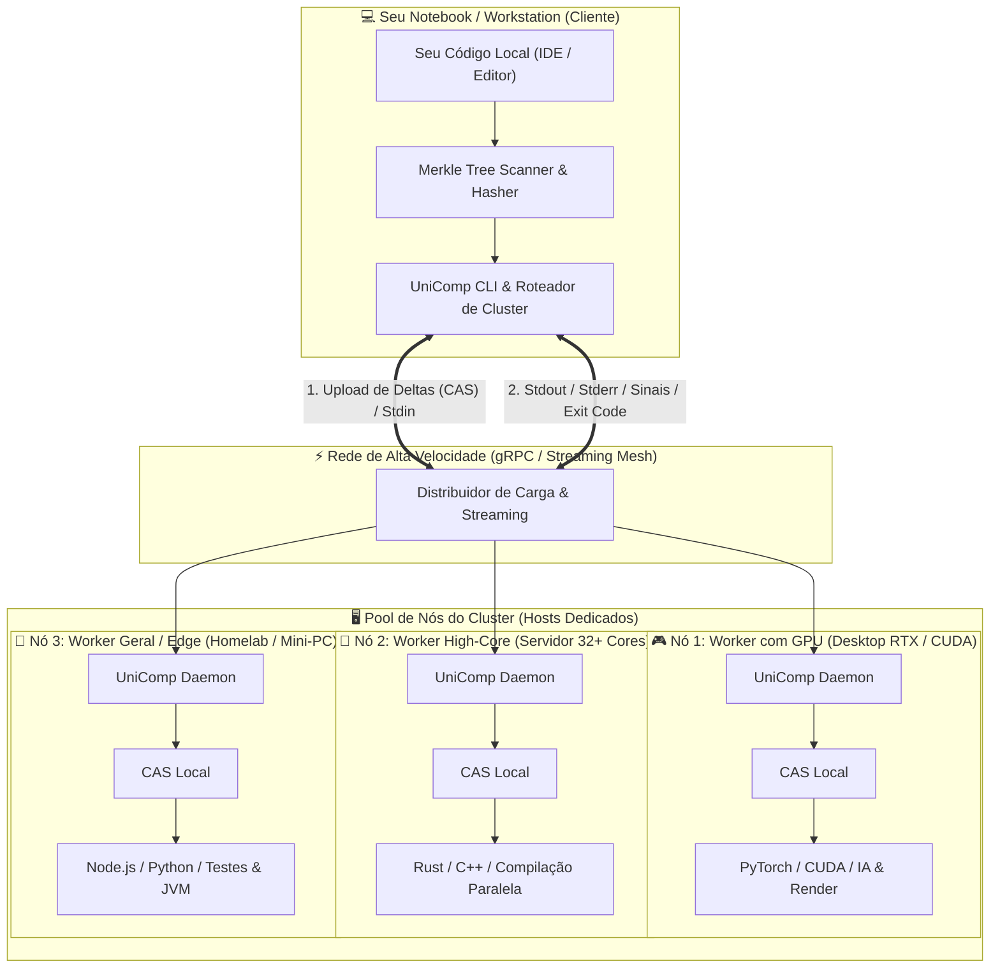

# UniComp (Compilador Único / Universal Remote Execution Engine)

<p align="center">
  <a href="https://github.com/MaxwellAt/UnifiedCompiler/blob/main/LICENSE"></a>
  <a href="https://www.rust-lang.org/"></a>
  
  
</p>

<p align="center">
  <b>A força de processamento do seu cluster ou computador dedicado com a ergonomia do seu notebook local.</b><br>
  <i>Sem SSH. Sem Git push/pull manual. Sem dualidade de ambientes.</i>
</p>

<p align="center">
  <a href="README_EN.md">🌐 <b>English Version</b></a> •
  <a href="VISION.md">💡 <b>Manifesto & Visão</b></a> •
  <a href="ROADMAP.md">🗺️ <b>Roadmap</b></a> •
  <a href="CONTRIBUTING.md">🤝 <b>Como Contribuir</b></a> •
  <a href="UNICOMP_ARCHITECTURE_SPEC.md">🔬 <b>Especificação Técnica</b></a>
</p>

---

## 💡 Por que o UniComp existe?

Desenvolvedores frequentemente possuem uma máquina potente disponível na rede (um desktop com GPU, uma workstation com muitos núcleos ou um servidor homelab), mas utilizam um notebook no dia a dia.

Hoje, usar essa máquina potente para rodar seu código exige um ritual desgastante:
1. Dar `git commit` e `git push` no notebook.
2. Acessar a outra máquina via SSH ou Remote Desktop.
3. Dar `git pull`.
4. Resolver dependências e versões que quebram no ambiente remoto (`pip`, `npm`, `rustup`, `java`).
5. Executar o comando e tentar inspecionar os logs longe do seu editor.

O **UniComp** elimina esse atrito. Inspirado na arquitetura do **Databricks Connect** e do **Google Bazel Remote Execution API (REAPI)**, ele transforma qualquer computador em um nó de execução transparente:

* O seu código permanece **100% no seu notebook**.
* O comando de execução é interceptado e redirecionado para a máquina dedicada.
* Apenas os arquivos modificados (**delta zero**) são enviados via rede usando Content-Addressable Storage (CAS).
* A compilação e a execução pesada acontecem no host remoto.
* O `stdout`, `stderr`, códigos de saída e métricas voltam para o seu terminal em tempo real como se o processo estivesse rodando na sua própria máquina (`localhost`).

---

## ⚖️ O Confronto: Fluxo Tradicional vs. UniComp

| Ação do Dia a Dia | Fluxo Tradicional (SSH / Git) | Fluxo com UniComp |
| :--- | :--- | :--- |
| **Testar alteração rápida** | `git add` ➔ `commit` ➔ `push` ➔ `ssh host` ➔ `pull` ➔ `run` | Apenas `unicomp run` (upload apenas do delta de bytes) |
| **Código não commitado (WIP)** | Força commits descartáveis sujos (`git commit -m "wip test"`) | Sincroniza o estado real do disco sem poluir o histórico Git |
| **Instalação de Dependências** | Acessar o host e rodar `pip`, `npm`, `cargo` manualmente | O Host resolve automaticamente em cache global isolado |
| **Visualização de Logs e Saídas** | Terminal remoto desconectado ou tail em arquivos | `stdout` e `stderr` renderizados no seu próprio terminal local |
| **Cancelamento (`Ctrl+C`)** | Deixa processo órfão no host ou exige matar PID manual | Sinal `SIGINT` é repassado instantaneamente ao processo remoto |
| **Hardware do Notebook** | Notebook esquenta, drena bateria e engasga com builds | Notebook permanece frio; o host assume 100% da carga |

> [!TIP]
> **Zero Commits Obrigatórios:** O UniComp lê diretamente os arquivos salvos no seu disco. Você pode testar ideias, rascunhos e debugar código sem precisar poluir o histórico do Git com commits de teste.

---

## 🏛️ Como Funciona o Sistema



---

## ⚡ Linguagens e Runtimes Suportados Nativa e Automaticamente

| Linguagem / Ecossistema | Detecção Automática | Estratégia de Build / Execução no Host |
| :--- | :--- | :--- |
| **Rust / C / C++** | `Cargo.toml` | Compilação remota nativa via `cargo run --release` com reaproveitamento de cache. |
| **Python** | `pyproject.toml`, `requirements.txt`, `main.py` | Execução com Python/uv isolado e hidratação rápida de dependências. |
| **Node.js / TypeScript** | `package.json`, `index.js` | Execução via `node` / `npm start` / `pnpm` com store compartilhada. |
| **JVM (Java / Kotlin)** | `pom.xml`, `build.gradle`, `*.java` | Compilação e execução via JVM (`javac` + `java` ou Gradle). |
| **Comando Personalizado** | Qualquer script ou binário | Flag `-- <comando>` para executar qualquer pipeline arbitrário. |

> [!NOTE]
> Você **não precisa** ter o compilador ou runtime instalado no seu notebook. Se o seu notebook não tem Rust ou Python instalados, mas a máquina dedicada tem, o UniComp envia seu código e o executa perfeitamente.

---

## 🚀 Guia Rápido de Instalação e Teste

### 1. Compilar o Binário Único (Rust)
```bash
cargo build --release
```
O executável compilado estará em `./target/release/unicomp` (ou `unicomp.exe` no Windows).

### 2. Iniciar o Host (Na Máquina Potente / Cluster)
```bash
unicomp daemon --bind 0.0.0.0:9876
```

### 3. Verificar o Host (No seu Notebook)
```bash
unicomp check --host 192.168.1.50:9876
```

### 4. Executar Seus Projetos Remotamente
```bash
# Executar projeto Python (exemplo de Monte Carlo)
unicomp run --host 192.168.1.50:9876 --dir examples/python_job

# Executar projeto Rust pesado
unicomp run --host 192.168.1.50:9876 --dir examples/rust_job

# Executar projeto Node.js
unicomp run --host 192.168.1.50:9876 --dir examples/node_job -- node index.js

# Executar projeto Java / JVM
unicomp run --host 192.168.1.50:9876 --dir examples/java_job
```

---

## ❓ Perguntas Frequentes (FAQ)

### O UniComp é um concorrente do Docker?
**Não.** O Docker exige a escrita de `Dockerfiles` e a criação de imagens pesadas (`docker build`), o que introduz alto atrito para testar alterações rápidas. O UniComp executa sobre runtimes nativos do host de forma quase instantânea com sincronização de deltas em nível de arquivo.

### O UniComp envia meu código para a nuvem de terceiros?
**Não.** O UniComp opera diretamente ponto-a-ponto entre os seus computadores (via cabo ethernet, Wi-Fi local, VPN Tailscale/WireGuard ou rede interna). Seu código nunca transita por servidores externos.

### O que acontece quando eu cancelo a execução com `Ctrl+C`?
O cliente intercepta o sinal e envia imediatamente uma mensagem de interrupção para o host daemon, que propaga o `SIGINT` para a árvore de processos remota, evitando que scripts orfãos fiquem rodando em segundo plano.

---

## 🗺️ Roadmap de Evolução

Consulte o [**`ROADMAP.md`**](ROADMAP.md) para conferir os marcos futuros, incluindo:
- Descoberta automática de nós na rede local via mDNS (sem precisar digitar IP).
- Arquivo de configuração `.unicomp.toml`.
- Extensão para VS Code e Cursor.
- Pool de nós com balanceamento automático por GPU vs. CPU.

---

## 🤝 Como Contribuir

Contribuições em código, documentação e sugestões são muito bem-vindas!  
Consulte o [**Guia de Contribuição (`CONTRIBUTING.md`)**](CONTRIBUTING.md) para detalhes de desenvolvimento e testes.

---

## 📄 Licença

Distribuído sob licença aberta [GNU Affero General Public License v3 (AGPL-3.0)](LICENSE).
