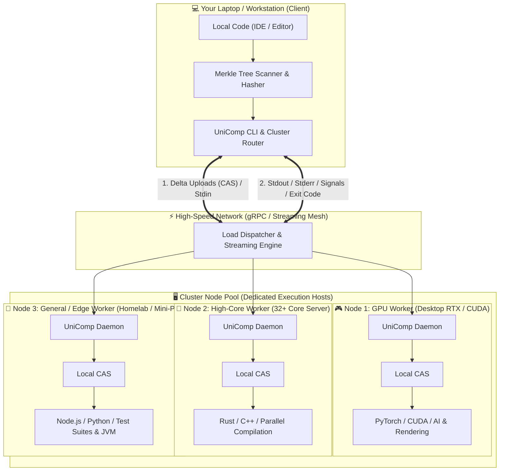

# UniComp (Universal Distributed Compiler & Remote Execution Engine)

<p align="center">
  <a href="https://github.com/MaxwellAt/UnifiedCompiler/blob/main/LICENSE"></a>
  <a href="https://www.rust-lang.org/"></a>
  
  
</p>

<p align="center">
  <b>The raw processing power of your cluster or dedicated desktop with the ergonomics of your local laptop.</b><br>
  <i>No SSH. No manual Git push/pull. No environment divergence.</i>
</p>

<p align="center">
  <a href="README.md">🇧🇷 <b>Versão em Português</b></a> •
  <a href="VISION.md">💡 <b>Manifesto & Vision</b></a> •
  <a href="ROADMAP.md">🗺️ <b>Roadmap</b></a> •
  <a href="CONTRIBUTING.md">🤝 <b>Contributing</b></a> •
  <a href="UNICOMP_ARCHITECTURE_SPEC.md">🔬 <b>Technical Spec</b></a>
</p>

---

## 💡 Why UniComp Exists

Developers often have a powerful machine available on their network (a desktop with a discrete GPU, a multi-core workstation, or a homelab server), but do their day-to-day coding on a lightweight laptop.

Today, using that secondary machine to run your code requires an exhaustive, friction-heavy ritual:
1. `git commit` and `git push` on your laptop.
2. SSH or Remote Desktop into the remote machine.
3. `git pull`.
4. Fix missing dependencies or version mismatches (`pip`, `npm`, `rustup`, `java`).
5. Execute the command and struggle to inspect output away from your IDE.

**UniComp eliminates this friction.** Inspired by the decoupled client-server architecture of **Databricks Connect** and the **Google Bazel Remote Execution API (REAPI)**, it turns any computer into a transparent execution node:

* Your code stays **100% on your laptop**.
* Execution commands are intercepted and redirected to the dedicated machine.
* Only modified files (**zero-delta**) are transmitted using Content-Addressable Storage (CAS).
* Heavy compilation and execution happen natively on the remote host.
* `stdout`, `stderr`, exit codes, and telemetry stream back to your local terminal in real time as if running on `localhost`.

---

## ⚖️ The Comparison: Traditional Workflow vs. UniComp

| Daily Developer Action | Traditional Workflow (SSH / Git) | UniComp Workflow |
| :--- | :--- | :--- |
| **Testing a single line edit** | `git add` ➔ `commit` ➔ `push` ➔ `ssh` ➔ `pull` ➔ `run` | Just `unicomp run` (only delta bytes uploaded) |
| **Uncommitted WIP code** | Forces dirty throwaway commits (`git commit -m "wip"`) | Syncs real disk state without polluting Git history |
| **Dependency setup** | Manually SSH in and run `pip`, `npm`, `cargo` | Host automatically hydrates isolated global caches |
| **Viewing logs and outputs** | Disconnected remote terminal or tailing logfiles | `stdout` & `stderr` rendered directly in your local terminal |
| **Interrupting (`Ctrl+C`)** | Leaves orphaned processes or requires manual `kill -9` | `SIGINT` forwarded instantly to remote process tree |
| **Laptop temperature & battery** | Laptop gets hot, drains battery, chokes on heavy builds | Laptop stays cool; host shoulders 100% of compute |

> [!TIP]
> **Zero Commits Required:** UniComp reads the live saved state from your local disk. Test experimental code, drafts, and benchmarks without polluting your commit history with test iterations.

---

## 🎯 The Two Execution Modes: Covering 100% of Workloads

Not every workload can be partitioned over a network (due to the shared memory barrier and sequential dependencies). UniComp solves this by operating across two complementary modes:

1. **Offload Mode (Single Dedicated Host):**
   * *Best for:* Strictly sequential code, heavy GPU training runs, or monolithic pipelines.
   * *How it works:* Dispatches the entire job to your fastest remote node. Your laptop stays cool and battery-efficient.
2. **Scatter-Gather Mode (Multi-Host Cluster - The Databricks Model):**
   * *Best for:* Partitionable batch workloads (compiling hundreds of `.c`/`.rs` files, data-parallel processing, test suites, simulations).
   * *How it works:* Slices work into $N$ chunks, sends one chunk to each node in your local cluster to run at full native speed, and aggregates the results back.

---

## 🏛️ System Architecture



---

## ⚡ Natively and Automatically Supported Runtimes

| Language / Ecosystem | Auto-Detection Trigger | Host Build & Execution Strategy |
| :--- | :--- | :--- |
| **Rust / C / C++** | `Cargo.toml` | Native remote compilation via `cargo run --release` with target cache reuse. |
| **Python** | `pyproject.toml`, `requirements.txt`, `main.py` | Isolated execution with Python/uv; fast sub-second dependency hydration. |
| **Node.js / TypeScript** | `package.json`, `index.js` | Execution via `node` / `npm start` / `pnpm` with shared global store. |
| **JVM (Java / Kotlin)** | `pom.xml`, `build.gradle`, `*.java` | Compilation and execution via host JVM (`javac` + `java` or Gradle). |
| **Custom Commands** | Any script or binary | `-- <command>` flag to offload arbitrary commands and pipelines. |

> [!NOTE]
> You **do not need** the compiler or runtime installed locally. If your laptop lacks Rust or Python, but your dedicated machine has them, UniComp offloads and runs the code transparently.

---

## 🚀 Quickstart & Testing

### 1. Build the Single Native Binary (Rust)
```bash
cargo build --release
```
The compiled binary will be located at `./target/release/unicomp` (or `unicomp.exe` on Windows).

### 2. Start the Host Daemon (On Dedicated Machine / Cluster)
```bash
unicomp daemon --bind 0.0.0.0:9876
```

### 3. Check Host Capabilities (From your Laptop)
```bash
unicomp check --host 192.168.1.50:9876
```

### 4. Run Projects Remotely
```bash
# Run Python workload (Monte Carlo Pi example)
unicomp run --host 192.168.1.50:9876 --dir examples/python_job

# Run intensive Rust project
unicomp run --host 192.168.1.50:9876 --dir examples/rust_job

# Run Node.js project
unicomp run --host 192.168.1.50:9876 --dir examples/node_job -- node index.js

# Run Java / JVM project
unicomp run --host 192.168.1.50:9876 --dir examples/java_job
```

---

## ❓ Frequently Asked Questions (FAQ)

### Is UniComp competing with Docker?
**No.** Docker requires writing `Dockerfiles` and building heavy container images (`docker build`), which creates too much friction during iterative debugging. UniComp runs directly on native host runtimes with sub-second, file-level delta synchronization.

### Does UniComp send code to a third-party cloud?
**No.** UniComp operates strictly peer-to-peer between your own computers (via ethernet, local Wi-Fi, Tailscale/WireGuard VPN, or internal networks). Your code never touches external cloud servers.

### What happens when I press `Ctrl+C`?
The client immediately intercepts the signal and sends an interruption message to the host daemon, which forwards `SIGINT` to the remote process tree, preventing orphaned background tasks on the host.

---

## 🗺️ Roadmap

Check out [`ROADMAP.md`](ROADMAP.md) for planned milestones:
- Automatic LAN discovery via mDNS (no manual IP typing).
- Local `.unicomp.toml` configuration files.
- Extensions for VS Code and Cursor.
- Multi-host clustering with intelligent GPU vs. CPU load balancing.

---

## 🤝 Contributing

Contributions in code, documentation, and architecture proposals are warmly welcomed!  
See the [**Contributing Guide (`CONTRIBUTING.md`)**](CONTRIBUTING.md) for development setup and testing guidelines.

---

## 📄 License

Distributed under the open-source [GNU Affero General Public License v3 (AGPL-3.0)](LICENSE).
