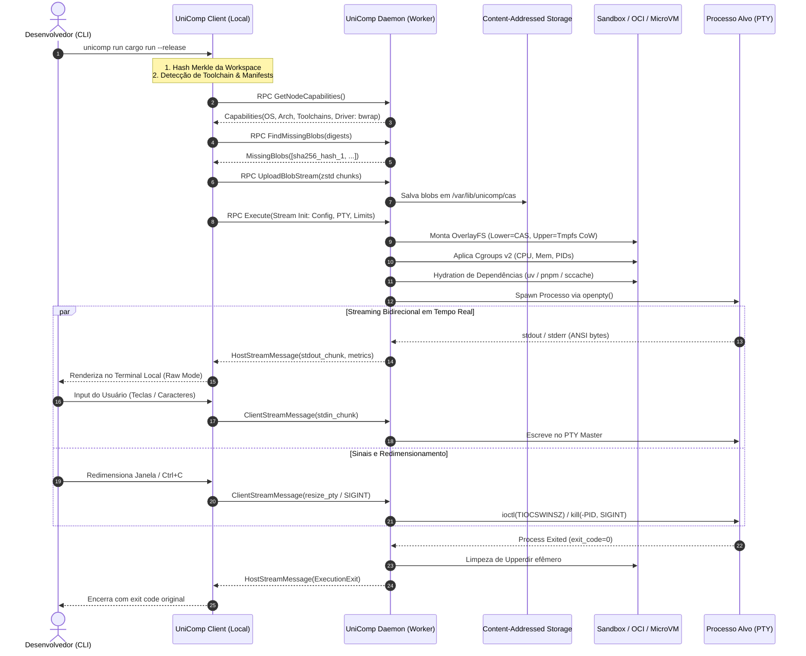
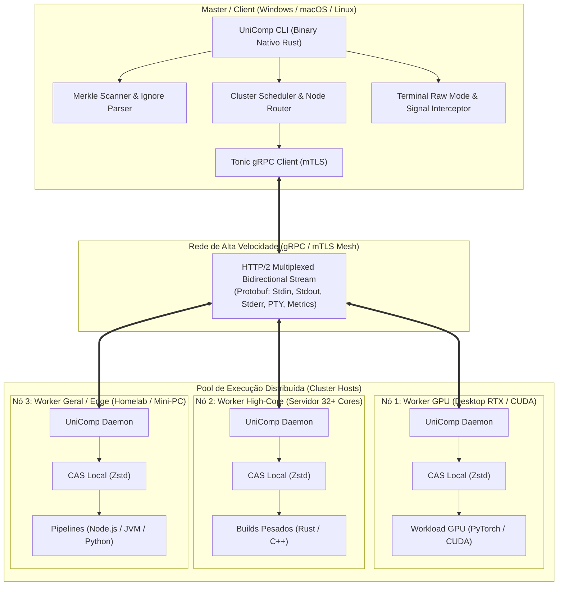

# UniComp: Análise Técnica e Arquitetura de Baixo Nível

## 1. Topologia e Fluxo de Dados Bidirecional



---

## 2. Diagrama de Camadas da Arquitetura do Cluster


```

---

## 3. Matrizes de Comparação e Trade-Offs

### 3.1. Estratégia de Build: Local vs. Remoto vs. Híbrido CAS
| Critério | Cross-Compilação Local | Compilação Remota Simples | UniComp Híbrido (CAS + Remote Incremental) |
| :--- | :--- | :--- | :--- |
| **Portabilidade Master/Host** | Péssima (quebra com C-bindings, glibc e SO) | Excelente (compila nativo no Linux) | **Excelente (compila nativo no Linux)** |
| **Uso de Banda de Rede** | Baixo (envia apenas binário gerado) | Alto (envia arquivos e dependências sempre) | **Ultra-baixo (envia apenas deltas via Merkle CAS)** |
| **Tempo de Execução (Cold)** | Rápido no host, mas lento/impossível no local | Lento (recria ambientes `npm`/`pip`/`cargo`) | **Rápido (hydratation via caches pré-aquecidos)** |
| **Tempo de Execução (Hot)** | Médio (recompilação local constante) | Médio (locks e compilações completas) | **Sub-segundo (sccache + uv instantâneo)** |
| **Complexidade de Toolchain** | Altíssima (requer toolchains cross locais) | Baixa no client, média no host | **Mínima no client (client não precisa de toolchains)** |

### 3.2. Mecanismo de Sandbox e Isolamento
| Mecanismo | Overhead de CPU/Memória | Latência de Spawn | Segurança de Isolamento | Prós & Contras no UniComp |
| :--- | :--- | :--- | :--- | :--- |
| **Processo Direto (`fork/exec`)** | 0% | < 1ms | Nenhuma (perigoso) | Risco inaceitável de fork-bombs e invasão de host. |
| **Bubblewrap (`bwrap`) + cgroups v2** | < 0.1% | 2ms - 5ms | Alta (Namespaces + Seccomp + Cgroups) | **Recomendado para clusters de dev e times confiáveis.** |
| **Containers (`containerd` / `runc`)** | Baixo | 80ms - 200ms | Padrão OCI / Container | Ótimo para ambientes pré-customizados via Dockerfiles. |
| **MicroVMs (`Firecracker`)** | ~5MB RAM por VM | 15ms - 30ms | Máxima (Isolamento de Kernel KVM) | **Recomendado para nós compartilhados multi-tenant ou código não-confiável.** |

### 3.3. Protocolo de Streaming e Transporte
| Protocolo | Latência I/O | Multiplexação | Tipagem / Contrato | Decisão Arquitetural |
| :--- | :--- | :--- | :--- | :--- |
| **gRPC (HTTP/2) + mTLS** | < 1ms em LAN / < 25ms em WAN | Nativa (Streams bidirecionais por chamada) | Estrita (Protobuf v3) | **Padrão adotado no Core do UniComp.** |
| **WebSocket + TLS** | Baixa | Não-nativa (precisa de framing manual) | Não tipado (JSON/Raw) | Complexo para multiplexar stdin/stdout/resize/signals. |
| **QUIC / HTTP/3** | Mínima (0-RTT, sem TCP HoL) | Nativa em nível de pacote UDP | Alta | **Camada de transporte secundária para WAN/Wi-Fi instável.** |
